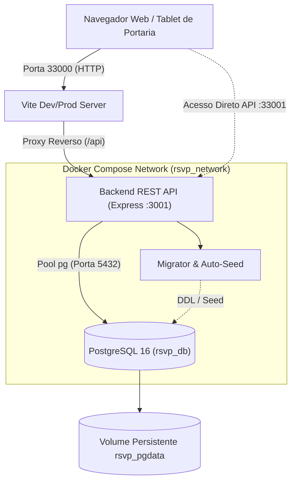
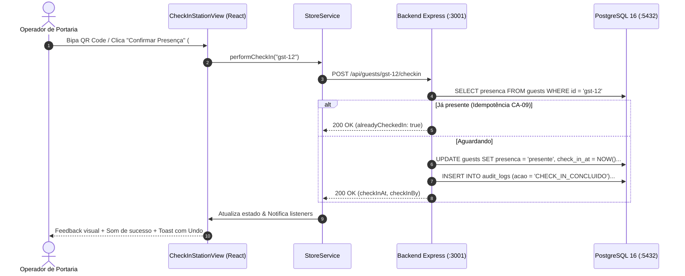

# Arquitetura do Sistema — Cerimonial & RSVP

Este documento detalha o desenho técnico, os padrões arquiteturais, o fluxo de dados e os princípios de isolamento do sistema **Cerimonial & RSVP**.

---

## 1. Visão Geral da Arquitetura

O sistema é construído sobre uma arquitetura em camadas desacoplada, composta por:

1. **Camada de Apresentação (Frontend):** SPA moderna desenvolvida em React 19, TypeScript e Tailwind CSS v4, empacotada com Vite.
2. **Camada de Aplicação (Backend):** Servidor HTTP leve em Node.js/Bun utilizando Express, responsável por validar permissões (RBAC), coordenar regras de protocolo de cerimonial e auditar operações.
3. **Camada de Persistência (Database):** Banco relacional PostgreSQL 16 Alpine, atuando como Fonte Única da Verdade (Single Source of Truth) com integridade referencial, chaves estrangeiras, índices e constraints estritas.

---

## 2. Padrões de Projeto & Estrutura do Código

### 2.1 Reatividade no Frontend com Store Central
O frontend utiliza uma `StoreService` centralizada implementando o padrão **Publisher/Subscriber**:
* **Cache em Memória:** As entidades `events`, `guests`, `users` e `auditLogs` residem na memória do cliente para renderização instantânea sem atrasos de digitação ou flickers.
* **Sincronização Bidirecional:** A inicialização e as mutações disparam requisições assíncronas para a API REST, refletindo imediatamente no PostgreSQL.
* **Isolamento de Sessão:** O `localStorage` é utilizado estritamente para reter o identificador do evento ativo (`cerimonial_active_event_id_v1`) e do usuário selecionado (`cerimonial_active_user_id_v1`), eliminando qualquer dado operacional sensível do armazenamento do navegador.

### 2.2 Isolamento de Ambientes & Portas Altas
Para garantir que a aplicação possa ser executada em qualquer máquina de desenvolvimento ou servidor de homologação sem colidir com outros bancos de dados ou serviços pré-existentes, todas as portas externas expostas no host foram alocadas em portas altas:

* **Host Port 33000:** Mapeada para a porta interna 3000 do container (Frontend Web).
* **Host Port 33001:** Mapeada para a porta interna 3001 do container (Backend API).
* **Host Port 25432:** Mapeada para a porta interna 5432 do container (PostgreSQL).

Dentro do container, a comunicação entre o proxy reverso do Vite e o servidor Express ocorre internamente via loopback (`http://127.0.0.1:3001`), eliminando dependência de portas externas ou resolução de DNS do host.

---

## 3. Fluxo de Vida dos Dados

---

## 4. Segurança & Integridade de Dados

1. **Role-Based Access Control (RBAC):**
   * `admin`: Acesso irrestrito a todos os eventos, reabertura de eventos encerrados (CA-14) e parametrizações globais.
   * `gestor`: Criação e edição de eventos autorizados, gestão completa de convidados e resolução de conflitos.
   * `operador`: Consulta, atualização de RSVP e credenciamento presencial (portaria).
   * `leitor`: Acesso somente leitura para auditores e fiscais de controle.
2. **Proteção Contra Formula Injection (CWE-1236 / CA-11):** Todas as células exportadas para planilhas eletrônicas são inspecionadas e desarmadas caso iniciem com caracteres executáveis (`=`, `+`, `-`, `@`).
3. **Numeração Sequencial Estável (CA-13):** Utilização de exclusão lógica (`deleted_at IS NULL`) impedindo a reutilização de numeração física de credenciais.
