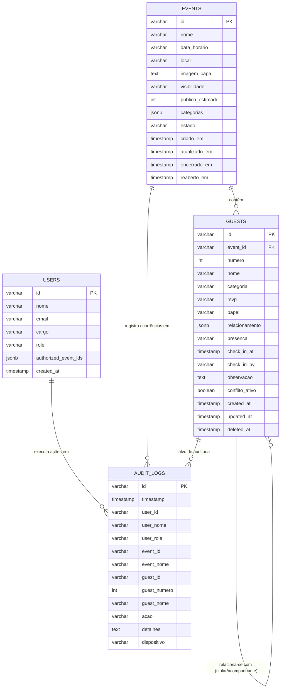

# Dicionário do Banco de Dados — PostgreSQL 16

O banco de dados oficial do sistema é o **PostgreSQL 16**, nomeado `rsvp_db`.

---

## 1. Diagrama Entidade-Relacionamento (ERD)

---

## 2. Dicionário de Tabelas

### 2.1 Tabela `users`
Armazena os operadores do sistema e suas permissões no modelo RBAC.

| Coluna | Tipo | Nulo? | Padrão | Descrição |
|---|---|---|---|---|
| `id` | `VARCHAR(64)` | NÃO | — | Chave primária (ex: `user-admin`) |
| `nome` | `VARCHAR(255)` | NÃO | — | Nome completo do operador |
| `email` | `VARCHAR(255)` | NÃO | — | E-mail funcional |
| `cargo` | `VARCHAR(255)` | NÃO | — | Cargo ou função no cerimonial |
| `role` | `VARCHAR(32)` | NÃO | — | Perfil (`admin`, `gestor`, `operador`, `leitor`) |
| `authorized_event_ids` | `JSONB` | NÃO | `'[]'::jsonb` | Lista de IDs de eventos com acesso concedido |
| `created_at` | `TIMESTAMP WITH TIME ZONE` | NÃO | `NOW()` | Carimbo de cadastro |

---

### 2.2 Tabela `events`
Armazena os eventos e suas configurações de capacidade e ciclo de vida.

| Coluna | Tipo | Nulo? | Padrão | Descrição |
|---|---|---|---|---|
| `id` | `VARCHAR(64)` | NÃO | — | Chave primária (ex: `evt-1`) |
| `nome` | `VARCHAR(255)` | NÃO | — | Título solene do evento |
| `data_horario` | `VARCHAR(255)` | NÃO | — | Data e horário legível/extenso |
| `local` | `VARCHAR(255)` | NÃO | — | Localização ou recinto solene |
| `imagem_capa` | `TEXT` | SIM | `NULL` | Imagem visual do evento |
| `visibilidade` | `VARCHAR(32)` | NÃO | `'reservado'` | `publico` ou `reservado` |
| `publico_estimado`| `INT` | NÃO | `100` | Capacidade estimada para cálculos |
| `categorias` | `JSONB` | NÃO | `'[]'::jsonb` | Categorias configuradas (CA-02) |
| `estado` | `VARCHAR(32)` | NÃO | `'ativo'` | `rascunho`, `ativo` ou `encerrado` (CA-14) |
| `criado_em` | `TIMESTAMP WITH TIME ZONE` | NÃO | `NOW()` | Data de criação |
| `atualizado_em`| `TIMESTAMP WITH TIME ZONE` | NÃO | `NOW()` | Última atualização cadastral |
| `encerrado_em` | `TIMESTAMP WITH TIME ZONE` | SIM | `NULL` | Carimbo de encerramento (CA-14) |
| `reaberto_em` | `TIMESTAMP WITH TIME ZONE` | SIM | `NULL` | Carimbo de reabertura auditada (CA-14) |

---

### 2.3 Tabela `guests`
Armazena a totalidade dos convidados, vínculos protocolares e presenças.

| Coluna | Tipo | Nulo? | Padrão | Descrição |
|---|---|---|---|---|
| `id` | `VARCHAR(64)` | NÃO | — | Chave primária |
| `event_id` | `VARCHAR(64)` | NÃO | — | Chave estrangeira para `events(id)` |
| `numero` | `INT` | NÃO | — | Numeração estável e sequencial (CA-13) |
| `nome` | `VARCHAR(255)` | NÃO | — | Nome completo do convidado |
| `categoria` | `VARCHAR(100)` | NÃO | — | Categoria obrigatória (CA-02) |
| `rsvp` | `VARCHAR(32)` | NÃO | `'pendente'` | `pendente`, `confirmado`, `recusado` |
| `papel` | `VARCHAR(32)` | NÃO | `'titular'` | `titular`, `acompanhante`, `representante` |
| `relacionamento`| `JSONB` | SIM | `NULL` | Metadados do titular vinculado e origem |
| `presenca` | `VARCHAR(32)` | NÃO | `'aguardando'` | `aguardando` ou `presente` |
| `check_in_at` | `TIMESTAMP WITH TIME ZONE` | SIM | `NULL` | Instante do credenciamento (CA-09) |
| `check_in_by` | `VARCHAR(255)` | SIM | `NULL` | Nome do operador de portaria |
| `observacao` | `TEXT` | SIM | `NULL` | Observações protocolares ou restrições |
| `conflito_ativo`| `BOOLEAN` | NÃO | `FALSE` | Sinalizador de conflito ativo (CA-06) |
| `created_at` | `TIMESTAMP WITH TIME ZONE` | NÃO | `NOW()` | Data de criação |
| `updated_at` | `TIMESTAMP WITH TIME ZONE` | NÃO | `NOW()` | Data da última alteração |
| `deleted_at` | `TIMESTAMP WITH TIME ZONE` | SIM | `NULL` | Soft delete para manter numeração estável (CA-13) |

---

### 2.4 Tabela `audit_logs`
Trilha imutável de auditoria institucional (CA-10).

| Coluna | Tipo | Nulo? | Padrão | Descrição |
|---|---|---|---|---|
| `id` | `VARCHAR(64)` | NÃO | — | Chave primária do log |
| `timestamp` | `TIMESTAMP WITH TIME ZONE` | NÃO | `NOW()` | Instante exato da ocorrência |
| `user_id` | `VARCHAR(64)` | NÃO | — | Identificador do usuário agente |
| `user_nome` | `VARCHAR(255)` | NÃO | — | Nome do operador responsável |
| `user_role` | `VARCHAR(32)` | NÃO | — | Perfil no momento da ação |
| `event_id` | `VARCHAR(64)` | NÃO | — | Evento afetado |
| `event_nome` | `VARCHAR(255)` | NÃO | — | Nome do evento |
| `guest_id` | `VARCHAR(64)` | SIM | `NULL` | Convidado afetado (se aplicável) |
| `guest_numero`| `INT` | SIM | `NULL` | Número sequencial do convidado |
| `guest_nome` | `VARCHAR(255)` | SIM | `NULL` | Nome do convidado |
| `acao` | `VARCHAR(100)` | NÃO | — | Tipo de ação (ex: `CHECK_IN_CONCLUIDO`, `DETECCAO_CONFLITO`) |
| `detalhes` | `TEXT` | NÃO | — | Descrição textual da operação |
| `dispositivo` | `VARCHAR(255)` | NÃO | — | User-Agent / dispositivo de origem |
